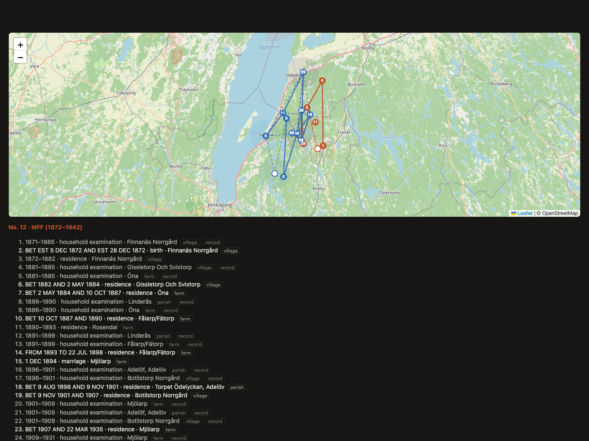
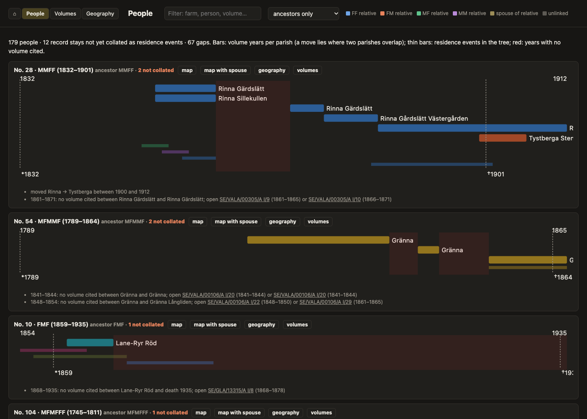
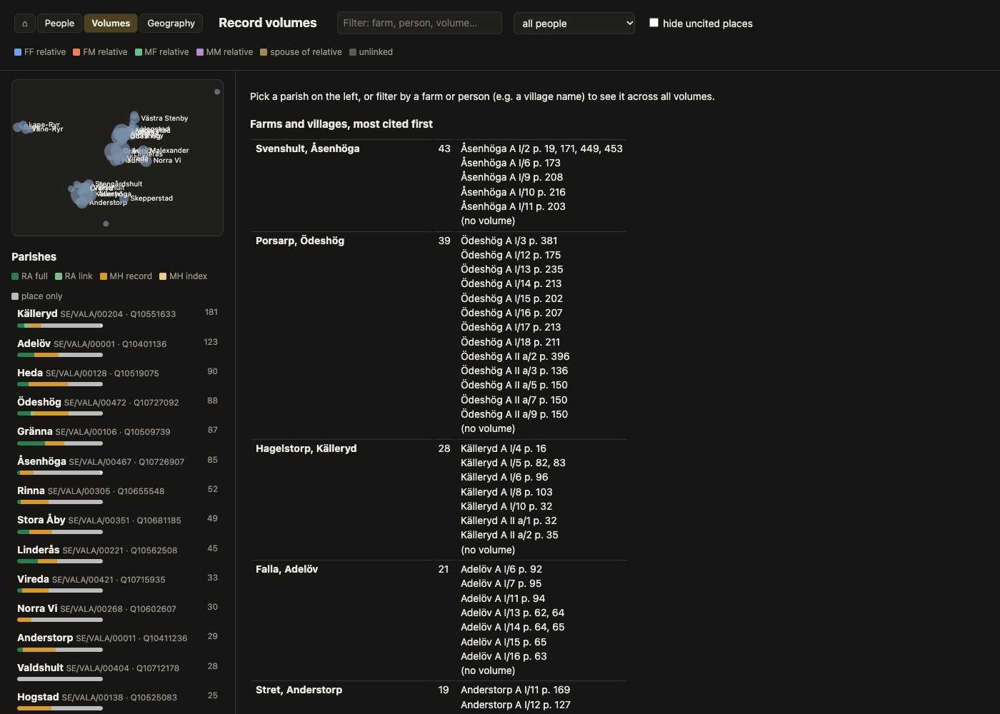
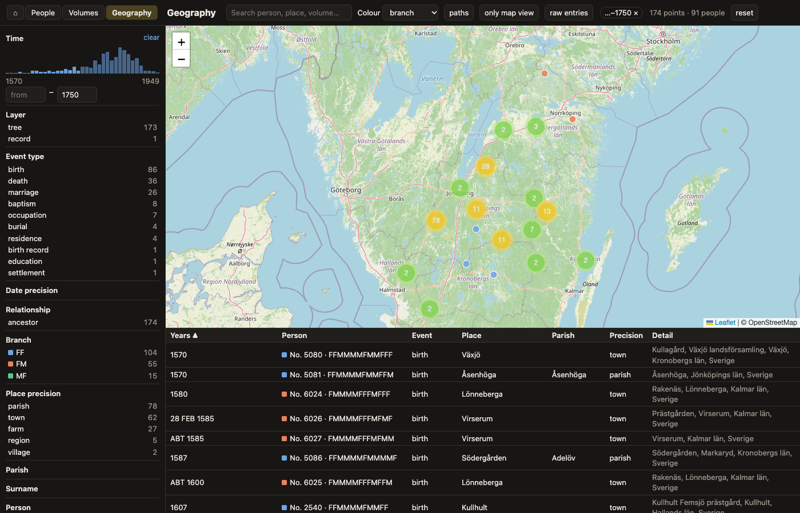

<div align="center">

# Synthetic Genealogy

Family history from DNA and records together: chromosome paintings that check the family tree, and a map of the records the tree was built from.

[](LICENSE) [](https://www.python.org/) [](https://github.com/UncleCJ/synthetic_genealogy/actions/workflows/tests.yml)

</div>

<div align="center">

### Släktforskare? Läs det här först

Det här är mitt hobbyprojekt för att lägga ihop släktträdet, kyrkböckerna och DNA-tester. Du behöver inte kunna något om DNA, och du behöver ingen AI. Allt är vanliga program som körs på din egen dator, och din data stannar hos dig. Vill du prova? Hör av dig, så sätter vi oss tillsammans.

</div>

<details>
<summary>Läs mer på svenska</summary>

- Från arkivsidan: programmen läser en vanlig GEDCOM-export, till exempel från MyHeritage. Varje ortnamn knyts till sin socken (med Riksarkivets referenskod) och, där det går, till gården. Varje källhänvisning blir volym och sida i husförhörslängden. Du får se vilka år som saknar källa, och vilken volym som skulle täcka luckan, plus en karta över varje anfaders liv.
- Från DNA-sidan: har några syskon testat sig, gärna med en förälder, kan programmen räkna ut vilken farfar, farmor, morfar eller mormor varje bit DNA kommer ifrån. Då hamnar varje DNA-matchning på en gren i trädet, och trädet och DNA:t kontrollerar varandra.
- Om AI: jag har skrivit mycket av koden med hjälp av AI. Det är bekvämt, men inget du behöver för att använda verktygen.
- Om integritet: inget laddas upp någonstans. DNA-uppgifter är känsliga enligt GDPR, så allt personligt stannar i en privat mapp.
- Delar du dina MyHeritage-matchningar med mig: [så laddar du ned segmenten](docs/myheritage-download.sv.md).
- Det här är ett pågående projekt, inte en färdig tjänst. Resten av sidan är på engelska och mer teknisk.

</details>

## Contents

- [What it is](#what-it-is)
- [Who it's for](#who-its-for)
- [Keeping your research private](#keeping-your-research-private)
- [Trying it](#trying-it)
- [Showcase](#showcase)
- [Documentation](#documentation)
- [Background](#background)
- [License](#license)

## What it is

Genealogy tools keep two things apart: the paths DNA took down a family tree, and the places and records the tree was built from. This project joins them, working from ordinary exports: a GEDCOM file, vendor segment and match lists, and raw DNA files where relatives lend them.

- **Records.** Every place in the tree goes to its parish (with Riksarkivet's reference code) and, where it can, to a farm or village; every citation becomes a volume and page. Residences become stays, the years no volume covers are listed with the volumes that would cover them, and each ancestor's life becomes a map.
- **DNA.** Siblings' raw data, ideally with a tested parent, are painted onto the four grandparents' copies of each chromosome, and every match segment is placed on one grandparent. The tree and the DNA then check each other: for one sibling, 210 of 238 segments from tree-linked matches land on the grandparent their tree path predicts, and most of the rest come from matches linked to the tree only by a common name.

Nothing edits the master tree; corrections are kept beside it with sources, so every view can be rebuilt and every disagreement stays visible. The code is readable Python sketches; treat it as unvalidated unless a check says otherwise.

**People: one couple's lives on a map.** Every residence, household examination, birth and marriage of a husband and wife, numbered in order and joined into paths. The list below the map gives the date, the farm or village, how precisely it is placed, and whether it comes from a cited record or only from the tree.



(People are pseudonymised; more views under [Showcase](#showcase).)

## Who it's for

My own family's research comes first. After that, a few pilots, who talk to me before they try it. It is not a public service.

## Keeping your research private

The code is public; the family's DNA and research are not. The project treats that as a feature, not an afterthought:

- **A data folder in layers** by what a file is: `input/` (downloads as received, never edited), `notes/` and `store/` (kept by hand), `cache/` and `output/` (rebuilt) ([docs/data.md](docs/data.md)).
- **Two lines of history:** public commits on `master`, and one `PRIVATE:` commit on top holding the data and config. A git pre-push hook and jj's `git.private-commits` refuse to push it ([docs/privacy-workflow.md](docs/privacy-workflow.md)).
- **Backups outside git:** `python3 backup.py status` lists hand-kept files that changed since the last backup to a private cloud folder, and `backup.py mark` records them; everything else is rebuilt by `pipeline.py`.
- **Snapshots:** `python3 backup.py snapshot` writes the outputs and notes as one dated zip that `serve.py` can browse on another computer.
- **A research log:** questions, hypotheses and findings as dated entries that cite the computed output ([schema](research/README.md); the entries stay private).
- **A pseudonymised showcase:** `showcase.py` makes the public screenshots on this page, with a check for names and ids.

## Trying it

The easiest way is together with me: get in touch. Alone, you need Python 3.11 or later:

```bash
git clone https://github.com/UncleCJ/synthetic_genealogy.git
cd synthetic_genealogy
pip install -r requirements.txt
python3 -m unittest discover -s tests      # synthetic data only, no private files
cp examples/family.example.toml family.toml # then describe your own kits, exports and tree
python3 pipeline.py                         # runs the chain, outputs to data/output/
python3 serve.py                            # browse the results on http://127.0.0.1:8000
```

[docs/pipeline.md](docs/pipeline.md) walks through each step with an anonymised run, and what a run on new data needs. To keep several families or experiments apart, point `FAMILY_CONFIG` at another `family.toml`.

## Showcase

The screenshots below come from one family's own data, as of November 2026. Places, parishes, volumes and pages are left as they are; people are pseudonymised ([showcase.py](showcase.py)). Only ancestors from the great-grandparents back are shown, each named by Ahnentafel number and lineage code: No. 12 · MFF is the mother's father's father. Colours are the four grandparent branches (FF, FM, MF, MM).

**DNA: one sibling's chromosomes painted by grandparent.** For each chromosome, the paternal lane sits above the maternal one. Pale blocks are the grandparent copies decoded from the siblings' and the mother's raw data. Placed match segments of 12 cM or more lie on top, with tree-linked ones darker. Each block is labelled with its support: the number of match segments placed on it, ✓ tree-linked segments that agree with its grandparent, and ✗ those that don't. The ✗ are the cases worth opening first.


**People: residence timelines.** One bar per stay, coloured by parish. Thin bars are the tree's own residence events. Red marks years where no household-examination volume is cited yet, and the notes below each person list the Riksarkivet volumes that would close the gap.



**Volumes: the references.** Each parish carries its Riksarkivet archive code and Wikidata item, with a bar showing how its citations are sourced. The densest farms are listed with every volume and page cited for them.



**Geography: every located event, filterable like a tag browser.** Facets by time, layer, event type, branch, precision of place and date, and parish. The address bar keeps the filter, so any view can be linked.


**Geography, way back: where each grandparent branch lived before 1750.** The same view, filtered to events before 1750.



## Documentation

| Document | What it covers |
| --- | --- |
| [docs/concepts.md](docs/concepts.md) | Principles, glossary and decisions |
| [docs/architecture.md](docs/architecture.md) | How the modules fit together, by layer |
| [docs/pipeline.md](docs/pipeline.md) | Each step in run order, with an anonymised run |
| [docs/data.md](docs/data.md) | The data folder's layers and viewing the results |
| [docs/myheritage-download.md](docs/myheritage-download.md) | Downloading MyHeritage segments, for testers sharing theirs ([svenska](docs/myheritage-download.sv.md)) |
| [docs/privacy-workflow.md](docs/privacy-workflow.md) | Public and private changesets (git and jj), backups |
| [docs/roadmap.md](docs/roadmap.md) | What comes next |
| [gazetteer/README.md](gazetteer/README.md) | The public gazetteer of parishes and farms |
| [research/README.md](research/README.md) | The research log's entry format |

## Background

The project started as an enumeration of what a "synthetic genealogy" could combine, written in October 2020 ([Synthetic Genealogy.md](https://gist.github.com/UncleCJ/6f9b36f55214e1d9ca5d128a9854e9f3)). Its 2026 revision, which marked each facet by where it stood and surveyed the tool landscape, is kept as the [README at commit 3e7bc20](https://github.com/UncleCJ/synthetic_genealogy/blob/3e7bc20e0669fcb98de3ba4b20e09edd9b89a854/README.md).

## License

Code: [MIT](LICENSE). The gazetteer's data draws on Wikidata, Riksarkivet and OpenStreetMap, whose own terms apply to it ([gazetteer/README.md](gazetteer/README.md)).
